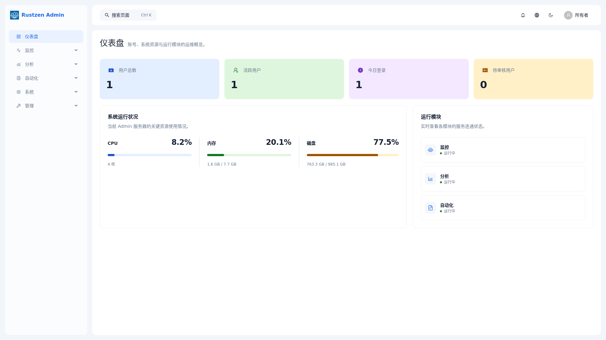
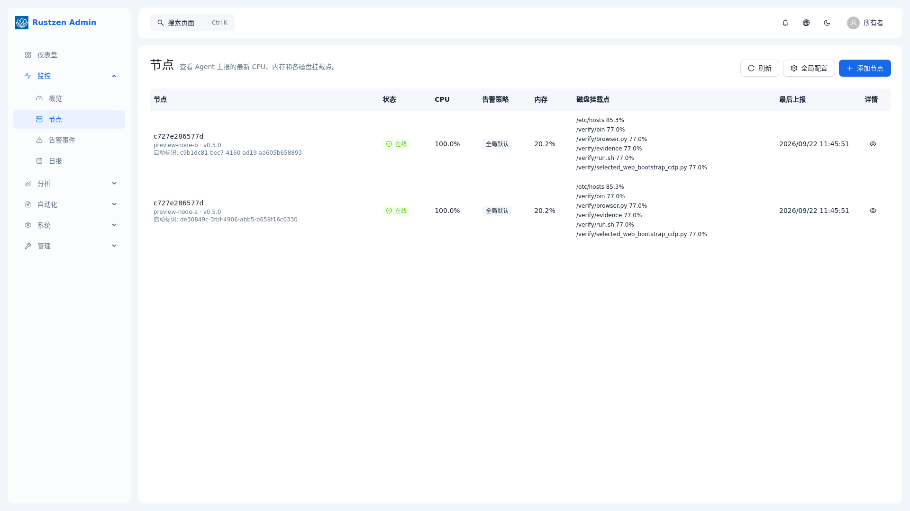
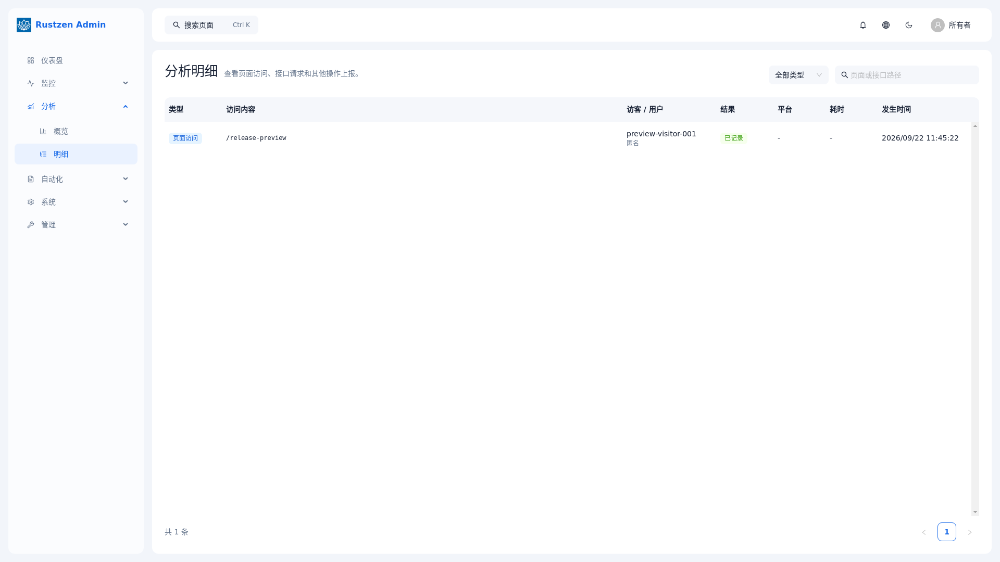
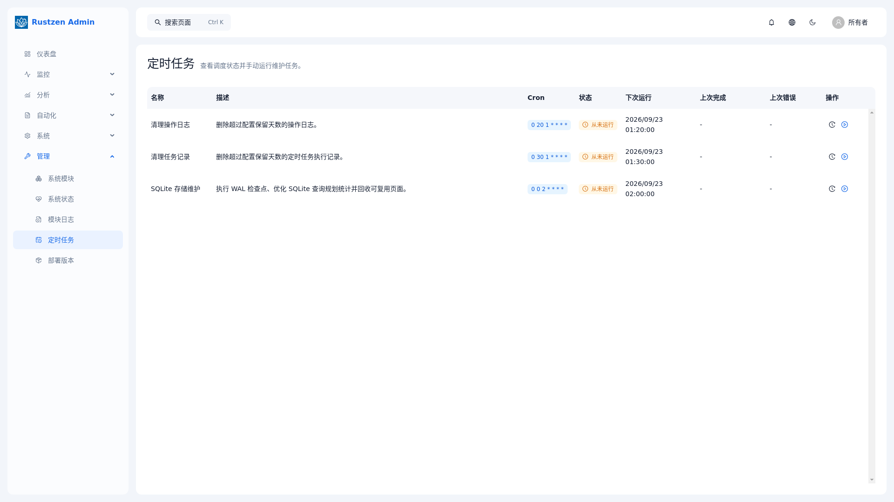

# rustzen-admin

[English](./README.md) | 简体中文

使用 **Rust、Axum、React 和 SQLite** 开发业务管理后台。

复用登录、实例级角色与权限、用户管理、审计日志，以及从前端到数据库的完整功能结构。Monitor、Insights 和 Reports 提供基于 Admin 基础能力的完整示例。

## 从这里开始

| 你想做什么 | 入口 |
| --- | --- |
| 先看看界面 | [演示环境](https://admin.rustzen.dev) — 仅演示账号：`owner` / `rustzen@123` |
| 本地运行并读懂一个功能 | [开发者快速上手](./docs/guides/getting-started.md) |
| 接入认证与权限 | [权限指南](./docs/guides/permission.md) |
| 安装完整签名发行包 | [部署指南](./docs/guides/deployment.md) |

当前默认构建完整应用。仅包含 Admin 的 `core` 组合仍在验收，其发行门禁见[组合任务账](./docs/product/features/composable-distribution/tasks.md)。部门数据权限与多租户隔离尚未实现。

## 概览

`rustzen-admin` 首先服务于开发业务管理后台的开发者：复用认证、实例级 RBAC、审计日志、共享布局和分层业务代码。部门数据权限与多租户隔离尚未实现。

Monitor、Insights 和 Reports 是 `full` 的扩展示例。已批准的 `core`/`full` 目标已有范围明确的验收记录：[OE 任务账](./docs/product/features/composable-distribution/tasks.md) 记录截至 2026-10-24 安装器工作及当前源码 Linux 测试包的原生运行、浏览器验收已被接受。真实上一版 full 0.5.1 发行物及其旧更新程序的兼容性仍未验证，并阻塞发行就绪。当前默认命令仍生成完整签名包、四个服务及各自 SQLite。core 默认值须在 OE-5 收口并验证命令接线后切换。运行时禁用只改变访问，不改变已安装组合。界面默认英文，支持切换并记住简体中文选择。

英文与中文入口应同步维护；产品事实以 [产品文档](./docs/product/product.md) 为准。

仓库采用 monorepo 组织方式：

- `crates/auth/` 包含 Rust 服务共享的认证与权限能力
- `crates/ipc/` 包含共享模块响应与分页、健康响应、Manifest、路由和 HMAC 委托契约
- `crates/storage/` 包含共享 SQLite 连接池和维护能力
- `apps/admin/` 包含 Admin API、网关、RBAC、发布管理和 Web 资源托管
- `apps/monitor/` 提供监控能力和可选的受管节点 Agent
- `apps/insights/` 提供产品分析和公共追踪脚本
- `apps/reports/` 提供报表模板、填报执行和实时运行视图
- `apps/cli/` 提供不常驻的统一运维命令 `rz`
- `apps/web/` 包含 React 前端应用
- `deploy/` 包含部署资产和发布支持文件
- `docs/` 包含仓库级架构与开发指南
- 仓库根目录保存共享命令、工作区元数据和协作入口文档

该结构明确了后端、前端和仓库规则，便于理解、审查和持续演进。

## 页面预览

以下为当前完整服务候选在 Linux 中运行时，以 1920×1080 浏览器视口截取的
代表性页面。19 个登录后业务路由均有候选截图；完整清单见
[发布截图索引](./docs/assets/screenshots/README.md)，验收边界见
[本地验证记录](./docs/guides/local-verification.md)。

| 仪表盘 | 监控节点 |
| --- | --- |
|  |  |

| 分析明细 | 自动任务 |
| --- | --- |
|  |  |

## 仓库结构

→ 架构概览：[docs/architecture.md](./docs/architecture.md)

## 产品方向

→ 产品定位、发展方向与模块边界：[docs/product/product.md](./docs/product/product.md)

## 文档

→ 完整文档索引：[docs/README.md](./docs/README.md)

## 命令入口

根目录 `justfile` 是命令的事实来源；执行前请先查看对应目标。
本地开发与测试构建保留可用回溯信息，但不生成完整变量级调试数据，避免大型
workspace 的 `target/` 被非必要调试信息持续放大。

```bash
cargo run -p rustzen-admin -- serve
cargo run -p rustzen-monitor -- controller
cargo run -p rustzen-insights -- serve
cargo run -p rustzen-reports -- serve
cargo run -p rustzen-cli -- --json doctor
```

部署包会把 `rz` 与四个服务二进制安装到同一
`/opt/rz/current/bin/` 目录，并创建 `/usr/local/bin/rz` 命令入口。`rz` 不加入 `rz-full.service`，不拥有数据库，
也不会合并四个服务的进程或故障域。整体服务命令为：

```bash
rz --help
rz start
rz stop
rz restart
rz status
```

直接查看 systemd 时统一使用 `systemctl status rz-full`；systemd 内部对应的
正式单元名是 `rz-full.service`。

正式发布只有一条安装路径：`just build` 生成包含 Web 与四个服务的签名完整包，
将包和构建生成的安装脚本复制到服务器，执行安装脚本后运行 `rz start`。
安装不要求输入管理员密码、签名密钥、验证公钥或数据库命令；首次启动时各服务
自行创建并校验其 SQLite 数据库。

完整构建产物统一生成到 `target/rz/`：

```text
target/rz/rz-<version>-<arch>.tar
target/rz/rz-install
```

前者是包含 Web、Admin、Monitor、Insights、Reports 和 `rz` 的签名完整包，
后者是服务器安装脚本。安装时只需把这两个文件复制到服务器：

```bash
sudo ./rz-install ./rz-<version>-<arch>.tar
sudo rz start
rz status
```

JSON 成功响应固定包含 `schema_version`、`ok`、`command` 和 `data`；
CLI 参数或执行失败固定包含 `schema_version`、`ok`、`command` 和
`error.code` / `error.message`。`doctor` 只按端点白名单读取配置，
凭据键不会进入 CLI 状态，也不会输出凭据值。

本地启动默认使用 SQLite，不需要 PostgreSQL。
SQLite 连接能力、角色策略、运行时目录和日志均由本仓库维护，不依赖 `rustzen-core` 运行时。
本地开发不需要 `.env`：数据库路径、端口、连接池限制、运行目录、日志、时区、JWT 有效期，以及仅用于开发的 JWT/IPC 密钥均有内置默认值。环境变量只用于覆盖这些默认值。

若启动提示 `VersionMismatch`，说明已有数据库与初始化迁移不匹配。请保留原库，按[上手指南的恢复说明](./docs/guides/getting-started.md#startup-recovery)核对数据归属与处理方式。

## 演示环境

- 本地演示地址：[https://admin.rustzen.dev](https://admin.rustzen.dev)
- 用户名：`owner`
- 演示密码：`rustzen@123`

该公开凭据仅用于上述演示环境。正式安装仍会随机生成初始密码，由服务器 root
用户从 `/opt/rz/data/initial-owner-password` 读取；用户修改密码后，以修改后的密码为准。

## 说明

- `README.md` 和 `AGENTS.md` 只保留轻量入口信息。
- `docs/history/` 保存历史执行记录，不是当前实现事实来源。

## 许可证与商标

源代码采用 [Apache License 2.0](./LICENSE.md) 许可，可在该许可证约束下进行商业使用、修改和分发。
Rustzen 名称、Logo、域名、官方包命名空间和官方分发渠道不包含在软件许可证授权范围内。详见 [NOTICE.md](./NOTICE.md) 和 [TRADEMARKS.md](./TRADEMARKS.md)。
